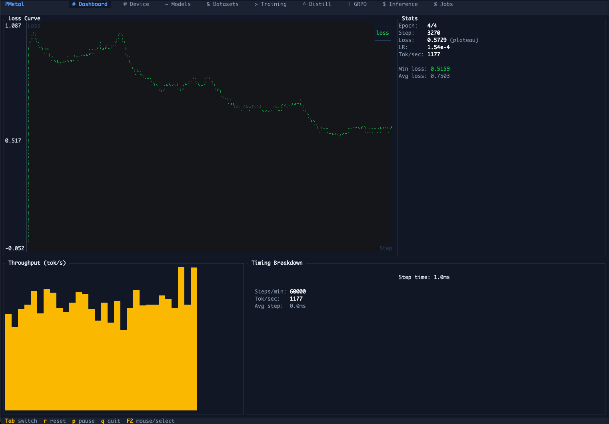
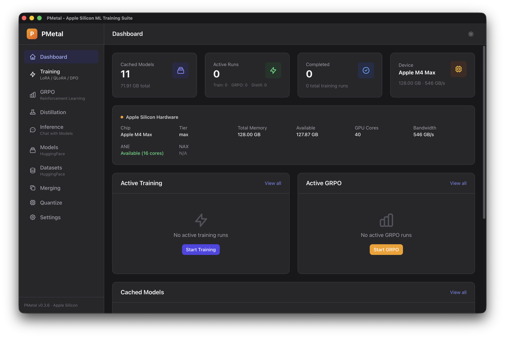

[](https://crates.io/crates/pmetal)
[](https://www.rust-lang.org)
[](LICENSE-MIT)
[-lightgrey.svg)](https://www.apple.com/macos)

# PMetal

**Powdered Metal**: fine-tuning, inference and serving for Apple Silicon, written in Rust.

PMetal trains and runs large language models on the Mac's GPU and Neural Engine, with no Python or CUDA in the loop. One tensor runtime (MLX under it, PMetal's own Metal kernels beside it) sits under a command line, a terminal UI, a desktop app, an MCP server, Python bindings and a Rust SDK.

What sets it apart:

- **One job spec for every surface.** Each command's fields, defaults, ranges and checks are defined once in `pmetal-core`; the CLI, TUI, GUI, MCP server and Python bindings are generated from it, so they cannot drift apart.
- **Fine-tuning with the full LoRA family.** LoRA, QLoRA, DoRA, rsLoRA, LoRA+ and PiSSA/OLoRA/LoftQ initialisation, with one adapter per routed expert on MoE models and QLoRA on NVFP4 checkpoints (the base stays packed). Adapters are written in the PEFT layout and agree with PEFT to 4e-6 in logits both ways.
- **Training adapts the model the server runs.** LoRA attaches to the same module graph inference uses, and the architectures are checked against reference outputs from `transformers`, so what you tune is what you serve.
- **Drafters trained on a Mac.** `train-mtp` and `train-draft` produce MTP predictors and DFlash block-diffusion drafts; `infer --mtp`, `infer --draft-model` and `dflash` use them for exact speculative decoding (every drafted token is verified).
- **Packed weights stay packed.** NVFP4, FP8 and MXFP4 checkpoints run in their stored form, MoE experts can be offloaded to SSD, and the KV cache can be TurboQuant-compressed to 2 to 4 bits.
- **One server, both API families.** OpenAI Chat Completions, Completions, Responses and Embeddings plus Anthropic Messages, with tool calls, grammar-constrained JSON-schema output, vision input and continuous batching.
- **The Neural Engine, for training and inference.** Whole-model inference on the ANE (with DFlash drafting), and an ANE training path.
- **Quantization you can budget.** GGUF output with importance matrices and KL-calibrated per-tensor types under a bits-per-weight target.
- **Multi-Mac training.** Thunderbolt-aware ring all-reduce with authenticated, encrypted links; ZeRO-1/2 optimizer sharding and DiLoCo are in the `pmetal-distributed` library.

Around that: GRPO, DAPO and GSPO; DPO, IPO, SimPO, ORPO and KTO; distillation; embedding-model training; pretraining; Hugging Face Hub search, download, upload and verification; model merging; and LoRA fusing.

## Quick start

```bash
brew install epistates/tap/pmetal

pmetal train --model Qwen/Qwen3-0.6B --dataset train.jsonl --output ./output
pmetal infer --model Qwen/Qwen3-0.6B --lora ./output/adapter_model.safetensors \
  --prompt "Explain quantum entanglement" --chat
pmetal serve --model Qwen/Qwen3-0.6B --port 8080
```

`train.jsonl` holds chat messages, ShareGPT, Alpaca, prompt/completion or plain text rows; the format is detected from the columns (see [Dataset formats](docs/training/overview.md#dataset-formats)). Models download from the Hugging Face Hub on first use. Other ways to install are under [Installation](#installation).

## Use PMetal your way

### Command line

```bash
# Fine-tune with LoRA (sequence packing and gradient checkpointing are on by default)
pmetal train --model Qwen/Qwen3-0.6B --dataset train.jsonl --output ./output \
  --lora-r 16 --batch-size 4 --learning-rate 2e-4

# QLoRA: the base model is packed to NF4 on the GPU
pmetal train --model Qwen/Qwen3-0.6B --dataset train.jsonl --quantization nf4

# Preference tuning, GRPO and distillation
pmetal preference --model Qwen/Qwen3-0.6B --dataset pairs.jsonl --loss dpo
pmetal grpo --model Qwen/Qwen3-0.6B --dataset reasoning.jsonl --reasoning-rewards
pmetal distill --teacher Qwen/Qwen3-4B --student Qwen/Qwen3.5-0.8B-Base --dataset train.jsonl

# Search the Hub with a fit estimate for this Mac, then merge, fuse and quantize
pmetal search "qwen 0.6b" --detailed
pmetal merge --model-a model-a --model-b model-b --method slerp --t 0.5 --output merged
pmetal fuse --model Qwen/Qwen3-0.6B --lora ./output/adapter_model.safetensors --output ./fused
pmetal quantize --model ./fused --output model.gguf --method q4_k_m

# Perplexity on a dataset, and a benchmark
pmetal eval --model Qwen/Qwen3-0.6B --dataset eval.jsonl
pmetal eval --model Qwen/Qwen3-0.6B --task gsm8k --limit 50
```

Speculative decoding with a Qwen3.6 checkpoint that bundles its own multi-token-prediction head, and with a predictor you trained yourself:

```bash
pmetal infer --model Qwen/Qwen3.6-35B-A3B --mtp --prompt "Explain monotonic queues."

pmetal tokenize --input train.jsonl --output ./tok --tokenizer Qwen/Qwen3.6-35B-A3B
pmetal train-mtp --model Qwen/Qwen3.6-35B-A3B --family qwen3-next \
  --shards ./tok/shard_00000.bin --output ./qwen-mtp
pmetal infer --model Qwen/Qwen3.6-35B-A3B --mtp --mtp-model ./qwen-mtp --prompt "Explain monotonic queues."
```

`pmetal <command> --help` lists every option; each command is documented under [`docs/cli/`](docs/cli/).

| Command | Description |
|---------|-------------|
| `train` | LoRA/QLoRA/DoRA fine-tuning (SFT); `--full` trains every weight and saves a whole model; `--ane` trains on the Neural Engine |
| `train-mtp` | Train a Gemma 4 assistant or a Qwen3Next/Qwen3.6 MTP predictor for speculative decoding |
| `train-draft` | Train a DFlash block-diffusion draft checkpoint |
| `train-diffusion` | LoRA/QLoRA fine-tune a DiffusionGemma block-diffusion model |
| `pretrain` | Pretrain from scratch (full-parameter, no LoRA) on tokenized shards |
| `preference` | DPO, Robust DPO, IPO, hinge, SimPO, ORPO or KTO with LoRA (alias `dpo`) |
| `grpo` | GRPO, DAPO, Dr. GRPO and GSPO reasoning training (VLM, reward models, reward commands, verifiers, async rewards) |
| `rlkd` | GRPO with a distillation term from a teacher |
| `distill` | Knowledge distillation (online, offline, progressive) |
| `embed-train` | Sentence-embedding fine-tuning (InfoNCE, triplet, CoSENT) |
| `infer` | Generation with chat, tools, thinking mode, images and video, speculative decoding |
| `decide` | Typed decisions from a Clef decision model in one forward pass |
| `serve` | OpenAI- and Anthropic-compatible server |
| `dflash` | Block-diffusion speculative decoding |
| `search`, `download`, `upload`, `verify` | Hugging Face Hub search with device fit, download, publish, integrity check |
| `merge`, `fuse`, `quantize` | Model merging, LoRA fusing, GGUF and MLX quantization |
| `eval` | Perplexity on a dataset, or a benchmark: GSM8K, MMLU, ARC, HellaSwag, IFEval subset, your own |
| `dataset`, `tokenize` | Dataset analysis, conversion and preparation; pretraining shards |
| `vocode` | Mel spectrogram to waveform with a BigVGAN vocoder |
| `ollama` | Modelfile generation for Ollama |
| `tui`, `dashboard` | The terminal UI; `dashboard` opens it on the Monitor tab |
| `mcp` | MCP server over stdio (56 tools) |
| `cluster` | Multi-Mac cluster: keys, discovery, status, benchmarks |
| `info`, `memory`, `init`, `completions` | Device report, memory report, sample training config, shell completions |
| `bench`, `bench-gen`, `bench-workload`, `bench-corpus`, `bench-gdn` | Training, generation, workload and kernel benchmarks |
| `pack-experts` | Pack MoE expert weights for SSD-offloaded inference |

`serve` and `mcp` are in the prebuilt binary and the Homebrew formula; if you build from source, add `--features serve,mcp`.

### Terminal UI



```bash
pmetal tui
```

21 tabs. Every job tab is a form built from the command's job spec; `S` shows the exact `pmetal` command and starts it as a supervised child process with a scrollable log, and quitting stops what you started.

| Tab | Description |
|-----|-------------|
| **System** | GPU and Neural Engine info, Metal features, memory against the device's working-set limit, UltraFusion topology |
| **Models** | Cached and local models with a fit estimate for this Mac; Hub search (`S`), download, fuse |
| **Datasets** | Local datasets (JSONL, Parquet, Arrow, CSV) with format readiness and a preview; convert to pmetal JSONL |
| **Tokenize**, **Pretrain** | Build pretraining shards; pretrain from scratch |
| **Training**, **EmbedTrain**, **Distill**, **RLKD**, **GRPO**, **Preference** | The training commands (`L` changes the learning rate of a running job) |
| **Monitor** | Live loss, learning rate, throughput and timing of a running or recorded run |
| **Inference** | Chat with a generation-settings sidebar |
| **DFlash**, **Serve** | Speculative decoding; the OpenAI-compatible server |
| **Quantize**, **Merge**, **Bench**, **Eval**, **Modelfile** | Model operations, benchmarks, Ollama Modelfiles |
| **Jobs** | Jobs from this session and finished runs found on disk, with logs |

`Ctrl+P` jumps to any tab, `Tab`/`Shift+Tab` cycle, `Alt+1`..`Alt+9` pick one of the first nine, `?` lists the keys of the current tab. See [`docs/cli/tui.md`](docs/cli/tui.md).

### Desktop app



A Tauri + Svelte app. Every `pmetal` command has a form drawn from its job spec, so the app cannot drift from the command line. Pages: Dashboard, Jobs, Train, Run (chat, server, DFlash), Models and Datasets (local and Hub), Tools (merge, fuse, quantize, Modelfile, pack experts), Measure (perplexity, benchmarks), Advanced and Settings.

Jobs run as `pmetal` processes under the shared job supervisor (the app bundles the CLI), carry on while you use other pages and are stopped when you quit. A Hugging Face token is kept in the macOS Keychain. Download the app from the [Releases](https://github.com/Epistates/pmetal/releases) page, or run it from source:

```bash
cd crates/pmetal-gui && bun install && bun tauri dev
```

### MCP server

`pmetal mcp` exposes 56 tools over stdio for Claude Desktop, Claude Code and other MCP clients: training, inference, model and dataset operations, device information and job control, with read-only resources and prompts. The tools are generated from the same job specs. See [`docs/cli/mcp.md`](docs/cli/mcp.md).

### Python

PyO3 bindings, one abi3 wheel for CPython 3.11 and later (macOS 14+, Apple Silicon). Every `pmetal` command is a typed spec class (`TrainSpec`, `GrpoSpec`, `MergeSpec`, ...) with the command line's fields, defaults and checks.

```python
import pmetal

# Fine-tune in this process (releases the GIL; Ctrl-C stops after the step and keeps the weights)
spec = pmetal.TrainSpec(model="Qwen/Qwen3-0.6B", dataset="train.jsonl", epochs=3, lora_r=16)
result = pmetal.Trainer(spec, callbacks=[pmetal.LoggingCallback(10)]).train()
print(result.final_loss, result.total_steps, result.weights_path)

# Any other command, as the command line runs it
pmetal.run(pmetal.MergeSpec(model_a="a", model_b="b", output="merged"))

# Inference
model = pmetal.Model.load("Qwen/Qwen3-0.6B")
print(model.generate("The capital of France is", max_tokens=16, temperature=0.0))
print(pmetal.infer("Qwen/Qwen3-0.6B", "What is 2+2?", chat=True, no_thinking=True))
```

See [`crates/pmetal-py/README.md`](crates/pmetal-py/README.md) and [`docs/python/`](docs/python/quick-start.md).

### Rust SDK

`pmetal` re-exports every sub-crate behind a feature flag, so one dependency gets you the framework. `orchestrator::run_training` is the one-call entry point the CLI itself uses:

```rust
use pmetal::trainer::orchestrator::{TrainingJobConfig, run_training};

let config = TrainingJobConfig {
    model_id: "Qwen/Qwen3-0.6B".to_string(),
    dataset: "train.jsonl".to_string(),
    output_dir: "./output".to_string(),
    ..Default::default()
};

let result = run_training(config, None, Vec::new()).await?;
println!("final loss {:.4} over {} steps", result.final_loss, result.total_steps);
```

Inference goes through the model dispatcher:

```rust
use pmetal::models::generate;
use pmetal::prelude::*;

let model_dir = pmetal::hub::resolve_model_path("Qwen/Qwen3-0.6B", None, None).await?;
let mut model = DynamicModel::load(&model_dir)?;
let tokenizer = Tokenizer::from_model_dir(&model_dir)?;

let input_ids = tokenizer.encode_with_special_tokens("What is 2+2?")?;
let output = generate(
    |input| model.forward(input, None),
    &input_ids,
    GenerationConfig::sampling(256, 0.7),
)?;
println!("{}", tokenizer.decode(&output.token_ids[input_ids.len()..])?);
```

For step-by-step control use the crates directly (`pmetal_trainer::TrainingLoop`, `pmetal_models::DynamicModel`, `pmetal_lora::DynamicLoraModel`, `pmetal_distill::Distiller`). Every code block in each crate's README is compiled as a doctest. See [`crates/pmetal/examples/`](crates/pmetal/examples/) and [`docs/sdk/advanced.md`](docs/sdk/advanced.md).

## Supported models

### Language models

Loaded from the Hugging Face Hub or a local directory; the architecture is detected from `config.json`. All of them work with the CLI, TUI, GUI, server and SDK. A `model_type` that is not listed is refused by name and never run as a similar family (see [Not supported yet](docs/models/supported.md#not-supported-yet)).

| Family | Variants | `model_type` values |
|--------|----------|---------------------|
| Llama | 2, 3, 3.1, 3.2, 3.3 | `llama`, `llama3` |
| Llama 4 | Scout, Maverick | `llama4`, `llama4_text` |
| Llama 3.2 Vision | 11B, 90B (image input) | `mllama`, `mllama_text_model` |
| Qwen 2 / 2.5 | dense | `qwen2`, `qwen2_5` |
| Qwen 3 | dense | `qwen3` |
| Qwen 3 MoE | e.g. Qwen3-30B-A3B | `qwen3_moe` |
| Qwen 3.5 / 3.6 / 3.8 | hybrid Gated DeltaNet, dense and MoE (image and video input) | `qwen3_next`, `qwen3_5`, `qwen3_5_moe`, `qwen3_6`, `qwen3_6_moe` |
| Qwen 3.8 Flash Next | text tower | `qwen4_exp` |
| DeepSeek | V2, V3, R1 (V3.2 and V4 are refused by name: the sparse-attention indexer is not implemented) | `deepseek_v2`, `deepseek_v3` |
| Mistral | 7B and the other dense Mistral decoders (Mixtral and the Mistral3 vision wrapper are refused by name) | `mistral` |
| Gemma | 1, 2, 3 | `gemma`, `gemma2`, `gemma3` |
| Gemma 4 | dense and MoE | `gemma4`, `gemma4_text` |
| DiffusionGemma | dense, MoE | `diffusion_gemma`, `diffusion_gemma_text` |
| Phi | Phi-3, Phi-3.5, Phi-4 | `phi3`, `phi4` |
| Cohere | Command R | `cohere`, `cohere2`, `command_r` |
| Granite | 3.x (including MoE), 4.0, 4.0-H | `granite`, `granitemoe`, `granitemoeshared`, `granitemoehybrid` |
| Nemotron-H, Nemotron 3 | hybrid Mamba-2 and attention (Nemotron 3 Nano and Super, Nemotron-H 4B to 12B) | `nemotron_h` |
| GPT-OSS | 20B, 120B (MXFP4 checkpoints run packed) | `gpt_oss` |
| Clef | decision models (`pmetal decide`, `/v1/systemone`) | Qwen3.5-family backbones |

Quantized checkpoints load packed: MLX-quantized (affine, mxfp4, nvfp4, mxfp8), NVIDIA ModelOpt NVFP4 and FP8, and gpt-oss MXFP4.

**Encoders**: BERT, RoBERTa, XLM-RoBERTa, CamemBERT, DistilBERT and ModernBERT (`bert`, `roberta`, `xlm-roberta`, `xlm_roberta`, `camembert`, `distilbert`, `modernbert`) run for embeddings (`/v1/embeddings`) and train with `pmetal embed-train`.

**Diffusion**: `pipelines::FluxPipeline` loads a `diffusers`-layout FLUX.1 directory (1-dev, 1-schnell) from `pmetal-models`; it has no tokenizer or CLI command yet.

**Fine-tuning**: LoRA and QLoRA (`--quantization nf4|fp4|int8`) apply to every architecture the dispatcher loads, with sequence packing, gradient checkpointing and the fused optimizer. The LM head, MoE routers and routed experts stay as loaded; LoRA adapts the routed experts of Qwen3-MoE, DeepSeek and Nemotron-H one adapter per expert. Adapters are written in the PEFT layout. DiffusionGemma trains through `train-diffusion`.

**Speculative decoding** (exact: every drafted token is verified, so output quality does not change):

- Gemma 4 MTP assistant checkpoints (`gemma4_assistant`) draft for a Gemma 4 target with `infer --draft-model`.
- Qwen3Next/Qwen3.6 checkpoints with bundled `mtp.*` weights (or a predictor from `train-mtp`) use `infer --mtp`; sampling controls carry through, and acceptance metrics are printed. LoRA and packed expert offload are separate modes: fuse the adapter first to combine them.
- DFlash drafts (including DFlash 2) run with `pmetal dflash` on a Qwen target, or with `infer --ane --draft-model` for a model on the Neural Engine. `train-draft` makes custom drafts.

See [`docs/models/supported.md`](docs/models/supported.md).

## Training methods

Every method below is a command with the same form in the CLI, TUI, GUI, MCP server and Python (the TUI has tabs for the ones in its list above).

| Method | Command | Library |
|--------|---------|---------|
| SFT, LoRA, QLoRA, DoRA, rsLoRA, LoRA+ | `train` (`--quantization`, `--dora`, `--rslora`) | `orchestrator::run_training()` |
| DPO, Robust DPO, IPO, hinge | `preference --loss dpo\|ipo\|hinge` | `PreferenceTrainer` |
| SimPO, ORPO | `preference --loss simpo\|orpo` | `PreferenceTrainer` |
| KTO | `preference --loss kto` | `KtoTrainer` |
| GRPO, DAPO | `grpo` (`--dapo`, `--loss-type`) | `GrpoTrainer` |
| Dr. GRPO, GSPO | `grpo --loss-type dr_grpo\|gspo` | `GrpoConfig::for_dr_grpo`, `for_gspo` |
| Knowledge distillation | `distill` | `Distiller` |
| TAID | not wired to a command | `TaidDistiller` |
| RLKD (GRPO plus distillation) | `rlkd` | `RlkdTrainer` |
| Embedding models | `embed-train` | `EmbeddingTrainer` |
| Pretraining | `pretrain` (with `--document-mask`) | `pmetal_trainer` |
| Block diffusion (DiffusionGemma) | `train-diffusion` | `DiffusionGemmaTrainer` |
| MTP and DFlash draft training | `train-mtp`, `train-draft` | `pmetal_trainer::mtp_training` |
| Neural Engine training | `train --ane` (experimental) | `AneTrainingLoop` |

Common to the training commands: optimizers `adamw`, `sgd`, `lion`, `adafactor`, `muon`, `adamw_schedule_free` and `adamw_8bit`; schedules `cosine`, `linear`, `constant`, `cosine_with_restarts`, `polynomial` and `wsd`; adaptive learning-rate control, best-loss checkpoint rollback, `--resume` that restores the optimizer, label smoothing, z-loss and NEFTune, `--cut-cross-entropy`, and live learning-rate steering from the TUI, GUI and MCP server. A training config can also be given as YAML (`pmetal init` writes a sample; see [`docs/configuration/config-file.md`](docs/configuration/config-file.md)). Details: [`docs/training/`](docs/training/overview.md).

## Notable technology

- **Own tensor runtime** (`pmetal-runtime`): arrays, autodiff, compiled graphs, native inference engines and custom Metal kernels, with MLX as the backend. Dense attention, RoPE, SwiGLU, LoRA and GEMM run as runtime ops; custom kernels cover what the runtime has no op for (fused Gated DeltaNet recurrence, fused AdamW, the Neural Engine's weight-gradient GEMM).
- **TurboQuant KV cache** (`infer --kv-turboquant`, native Qwen3, Qwen3.5 and Llama 4 engines): rotated, Lloyd-Max-quantized keys and values stored bit-packed, 1 to 8 bits per coordinate, with decode attending straight from the packed cache. At head dimension 128 that is 3.8x smaller than bf16 at 4 bits, 4.9x at 3 bits and 7.1x at 2 bits. Sinks and a recent window stay exact; each KV head's keys are centred and scaled from the first tokens the cache sees. On Qwen3-0.6B text this keeps 4-bit keys and values within 0.3% perplexity of bf16 and 3-bit within 2.3%.
- **Neural Engine**: training kernels compiled once, with weights packed beside activations in IOSurfaces; inference with the whole model on the ANE, several layers per program over a KV cache in IOSurfaces, int8 weights by default (`infer --ane`, `serve --ane`).
- **Server**: `/v1/chat/completions`, `/v1/completions`, `/v1/responses`, `/v1/embeddings`, `/v1/messages` and `/v1/models`, with streaming, tool calls parsed per model family, JSON-schema and `tool_choice` enforced by constrained decoding, `logit_bias`, logprobs, `reasoning_content`, images and videos (Qwen3.5 family, Llama 3.2 Vision), prefix caching, `--continuous-batch`, optional API keys and CORS origins. See [`crates/pmetal-serve/README.md`](crates/pmetal-serve/README.md).
- **Datasets**: JSONL, JSON, Parquet, Arrow and CSV, or a directory of shards; messages, ShareGPT, Alpaca, prompt/completion, reasoning and plain-text rows are detected automatically. `pmetal dataset` analyzes, converts, filters, splits and prepares them.
- **Merging**: 18 strategies in the library (14 on the command line: linear, SLERP, TIES, DARE, DELLA, task arithmetic, Breadcrumbs, Model Stock, consensus, Multi-SLERP, nearswap, passthrough and variants), streamed tensor by tensor from memory-mapped checkpoints, with FP8 inputs, layer slices and reproducible masks. See [`docs/models/merging.md`](docs/models/merging.md).
- **Quantization**: GGUF (24 methods including K-quants, ternary, MXFP4 and NVFP4, with `--imatrix` and KL-calibrated `--kl-calibrate --target-bpw`) and MLX-format output. See [`docs/models/quantization.md`](docs/models/quantization.md).
- **Distillation**: online, offline (compressed top-k, int8/int4 or sampled logit caches) and progressive; KL, reverse KL, Jensen-Shannon, skew KL, soft cross-entropy, MSE and cross-vocabulary universal-logit losses; rationale distillation; on-policy generation. See [`docs/training/distillation.md`](docs/training/distillation.md).

## Multi-Mac cluster

Connect two or more Apple Silicon Macs for data-parallel training. PMetal enumerates every network interface, advertises over mDNS and forms a ring biased toward the fastest fabric: Thunderbolt over Ethernet over Wi-Fi, without configuration. Links between ranks are authenticated and encrypted with a shared cluster secret, so every Mac needs the same one.

```bash
# Once, on one Mac; copy ~/.pmetal/cluster_secret (mode 600) to every other Mac
pmetal cluster keygen

# On every Mac
pmetal cluster status        # local interfaces and any peers already announcing
pmetal cluster up            # join the cluster and hold the connection open
pmetal cluster bench --mb 64 --iters 10                 # all-reduce throughput per fabric
pmetal cluster pipeline-bench --tokens 16 --layers 32   # pipeline activation transport

# Distributed training: run the same command on each Mac at the same time
pmetal train --model Qwen/Qwen3-0.6B --dataset train.jsonl --distributed-auto
```

Wired today: gradient all-reduce for multi-machine training, fabric-aware ring formation with fallback when a cable is unplugged, gradient compression (`--compression-strategy none|topk|fp16|random`), and a transport-tested pipeline harness. Serving a model that does not fit on one Mac (per-architecture partial-layer execution) is not wired yet.

## Hardware support

PMetal detects the Apple Silicon generation, tier, core counts, memory bandwidth and features at startup and tunes itself. Run `pmetal info` to see what it found.

| Chip family | GPU family | NAX | ANE | Status |
|-------------|-----------|-----|-----|--------|
| M1 / Pro / Max / Ultra | Apple7 | - | yes | Supported |
| M2 / Pro / Max / Ultra | Apple8 | - | yes | Supported |
| M3 / Pro / Max / Ultra | Apple9 | - | yes | Supported |
| M4 / Pro / Max | Apple9 | - | yes | Supported |
| M5 and later | Apple10 | yes | yes | Supported |

macOS 14 (Sonoma) or later. NAX (the neural accelerators in M5-generation GPU cores) is used through MLX's NAX kernels on macOS 26.2 or later. An Ultra is treated as two Max dies joined by UltraFusion. Details: [`docs/hardware-support.md`](docs/hardware-support.md).

## Installation

**Homebrew** (builds the CLI, TUI, server and MCP server from source against the pinned MLX):

```bash
brew install epistates/tap/pmetal
```

**Prebuilt binary.** Download the `pmetal-<version>-aarch64-apple-darwin.tar.gz` asset from the [Releases](https://github.com/Epistates/pmetal/releases) page. It holds the `pmetal` binary and the `mlx.metallib` it was built with:

```bash
tar xzf pmetal-v0.7.0-aarch64-apple-darwin.tar.gz
sudo install -m 755 pmetal-v0.7.0-aarch64-apple-darwin /usr/local/bin/pmetal
pmetal --version
```

**crates.io:**

```bash
cargo install pmetal --features serve,mcp
```

`serve` and `mcp` are off by default so library users do not inherit axum and rmcp; leave them out if you only want the training CLI and TUI. Building needs the Xcode command line tools, the Metal toolchain (`xcodebuild -downloadComponent MetalToolchain`) and CMake (`brew install cmake`). MLX is linked statically, so the installed binary is self-contained.

**From source:**

```bash
git clone https://github.com/epistates/pmetal.git && cd pmetal
cargo build --release --features serve,mcp   # target/release/pmetal
```

The repository pins its toolchain in `rust-toolchain.toml` (rustup installs it on first use); the minimum supported Rust version for library users is 1.95.

**Desktop app:** download the DMG from the Releases page, or `cd crates/pmetal-gui && bun install && bun tauri build`.

**Python:** the wheel is built from this repository with [maturin](https://www.maturin.rs) (it is not on PyPI yet):

```bash
cd crates/pmetal-py && pip install maturin && maturin develop --profile wheel
```

More detail, including GUI setup and troubleshooting: [`docs/installation.md`](docs/installation.md).

## Workspace

```text
crates/
├── pmetal-runtime      # Tensor runtime: arrays, autodiff, native engines, optimizers, custom Metal kernels
├── pmetal-core         # Configs, traits, error handling, the job specs every surface shares
├── pmetal-core-derive  # Derive macro for the job specs
├── pmetal-metal        # Metal context, ANE runtime and kernels
├── pmetal-cache        # KV caches, prefix reuse, speculative-decoding state
├── pmetal-models       # Model architectures, dispatcher, speculative decoders
├── pmetal-lora         # LoRA/QLoRA as a property of Linear
├── pmetal-trainer      # Training loops (SFT, preference, GRPO, MTP, ...)
├── pmetal-data         # Datasets, chat templates, tokenization, image processing
├── pmetal-hub          # Hugging Face Hub client and model fit estimation
├── pmetal-distill      # Knowledge distillation (losses, offline caches, TAID)
├── pmetal-merge        # Model merging and LoRA fusing
├── pmetal-gguf         # GGUF reader, writer and quantization
├── pmetal-mhc          # Manifold-Constrained Hyper-Connections
├── pmetal-distributed  # Ring all-reduce, mDNS discovery, authenticated transport
├── pmetal-vocoder      # BigVGAN neural vocoder
├── pmetal-serve        # OpenAI- and Anthropic-compatible server
├── pmetal-supervisor   # Runs pmetal commands as supervised child processes
├── pmetal-mcp          # MCP server (56 tools)
├── pmetal-py           # Python bindings (maturin / PyO3)
├── pmetal              # Umbrella crate: the CLI, the TUI and re-exports of the rest
└── pmetal-gui          # Desktop app (Tauri + Svelte), its own workspace
```

Cargo features of the umbrella crate (defaults: `cli`, `dashboard`, `trainer`, `lora`, `merge`, `vocoder`, `ane`, `distributed`) are listed in [`docs/configuration/feature-flags.md`](docs/configuration/feature-flags.md).

## Documentation

- [Getting started](docs/getting-started.md) and [installation](docs/installation.md)
- [CLI reference](docs/cli/train.md): one page per command
- [Training](docs/training/overview.md), [models](docs/models/supported.md), [Python](docs/python/quick-start.md) and [Rust SDK](docs/sdk/advanced.md)
- [Configuration file](docs/configuration/config-file.md) and [feature flags](docs/configuration/feature-flags.md)
- [Hardware](docs/hardware-support.md), [contributing](CONTRIBUTING.md), [security policy](SECURITY.md) and the [changelog](CHANGELOG.md)

## Development

```bash
just test         # workspace tests, single-threaded for Metal
just preflight    # everything CI runs
just kani-verify  # cargo-kani proofs for ring all-reduce and topology
```

## License

Licensed under either of [MIT](LICENSE-MIT) or [Apache-2.0](LICENSE-APACHE), at your option. Third-party attributions are in [THIRD_PARTY_NOTICES](THIRD_PARTY_NOTICES).

## Acknowledgments

- [MLX](https://github.com/ml-explore/mlx), Apple's array framework, which `pmetal-runtime` uses as its backend
- [Tauri](https://tauri.app), the desktop application framework
- The papers and reference implementations the individual features follow are cited where they are implemented; kernel techniques are attributed in [THIRD_PARTY_NOTICES](THIRD_PARTY_NOTICES)
